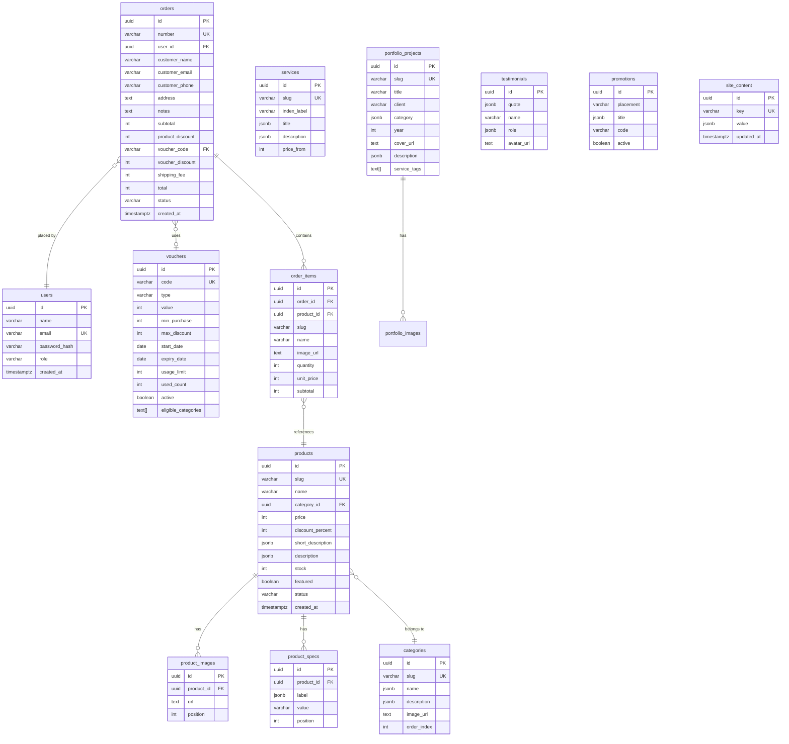

# Database Schema & Query Scenarios — Titiktiga

## Entity Relationship Diagram



---

## DDL — PostgreSQL

### 1. `users`
```sql
CREATE TABLE users (
  id            UUID PRIMARY KEY DEFAULT gen_random_uuid(),
  name          VARCHAR(120) NOT NULL,
  email         VARCHAR(255) NOT NULL UNIQUE,
  password_hash VARCHAR(255) NOT NULL,
  role          VARCHAR(20)  NOT NULL DEFAULT 'customer'
                CHECK (role IN ('customer','admin')),
  created_at    TIMESTAMPTZ  NOT NULL DEFAULT now()
);
CREATE INDEX idx_users_email ON users(email);
```

### 2. `categories`
```sql
CREATE TABLE categories (
  id          UUID PRIMARY KEY DEFAULT gen_random_uuid(),
  slug        VARCHAR(100) NOT NULL UNIQUE,
  name        JSONB        NOT NULL, -- { "id": "...", "en": "..." }
  description JSONB        NOT NULL,
  image_url   TEXT,
  order_index INT          NOT NULL DEFAULT 0
);
CREATE INDEX idx_categories_order ON categories(order_index);
```

### 3. `products`
```sql
CREATE TABLE products (
  id                UUID PRIMARY KEY DEFAULT gen_random_uuid(),
  slug              VARCHAR(200) NOT NULL UNIQUE,
  name              VARCHAR(200) NOT NULL,
  category_id       UUID         REFERENCES categories(id) ON DELETE SET NULL,
  price             INT          NOT NULL CHECK (price >= 0),
  discount_percent  INT          CHECK (discount_percent BETWEEN 0 AND 100),
  short_description JSONB        NOT NULL,
  description       JSONB        NOT NULL,
  stock             INT          NOT NULL DEFAULT 0 CHECK (stock >= 0),
  featured          BOOLEAN      NOT NULL DEFAULT false,
  status            VARCHAR(20)  NOT NULL DEFAULT 'draft'
                    CHECK (status IN ('active','draft')),
  created_at        TIMESTAMPTZ  NOT NULL DEFAULT now()
);
CREATE INDEX idx_products_category   ON products(category_id);
CREATE INDEX idx_products_status     ON products(status);
CREATE INDEX idx_products_featured   ON products(featured) WHERE featured = true;
CREATE INDEX idx_products_created_at ON products(created_at DESC);
-- Aktifkan pg_trgm untuk full-text search:
-- CREATE EXTENSION IF NOT EXISTS pg_trgm;
-- CREATE INDEX idx_products_name_trgm ON products USING gin(name gin_trgm_ops);
```

### 4. `product_images`
```sql
CREATE TABLE product_images (
  id         UUID PRIMARY KEY DEFAULT gen_random_uuid(),
  product_id UUID NOT NULL REFERENCES products(id) ON DELETE CASCADE,
  url        TEXT NOT NULL,
  position   INT  NOT NULL DEFAULT 0
);
CREATE INDEX idx_product_images_product ON product_images(product_id, position);
```

### 5. `product_specs`
```sql
CREATE TABLE product_specs (
  id         UUID PRIMARY KEY DEFAULT gen_random_uuid(),
  product_id UUID  NOT NULL REFERENCES products(id) ON DELETE CASCADE,
  label      JSONB NOT NULL,
  value      VARCHAR(255) NOT NULL,
  position   INT  NOT NULL DEFAULT 0
);
CREATE INDEX idx_product_specs_product ON product_specs(product_id, position);
```

### 6. `vouchers`
```sql
CREATE TABLE vouchers (
  id                  UUID PRIMARY KEY DEFAULT gen_random_uuid(),
  code                VARCHAR(50) NOT NULL UNIQUE,
  type                VARCHAR(20) NOT NULL CHECK (type IN ('percentage','fixed')),
  value               INT         NOT NULL CHECK (value > 0),
  min_purchase        INT         NOT NULL DEFAULT 0,
  max_discount        INT,
  start_date          DATE        NOT NULL,
  expiry_date         DATE        NOT NULL,
  usage_limit         INT,
  used_count          INT         NOT NULL DEFAULT 0,
  active              BOOLEAN     NOT NULL DEFAULT true,
  eligible_categories TEXT[]
);
CREATE INDEX idx_vouchers_code   ON vouchers(UPPER(code));
CREATE INDEX idx_vouchers_active ON vouchers(active) WHERE active = true;
```

### 7. `orders`
```sql
CREATE TABLE orders (
  id               UUID PRIMARY KEY DEFAULT gen_random_uuid(),
  number           VARCHAR(30)  NOT NULL UNIQUE,
  user_id          UUID         REFERENCES users(id) ON DELETE SET NULL,
  customer_name    VARCHAR(120) NOT NULL,
  customer_email   VARCHAR(255) NOT NULL,
  customer_phone   VARCHAR(30),
  address          TEXT         NOT NULL,
  notes            TEXT         NOT NULL DEFAULT '',
  subtotal         INT          NOT NULL CHECK (subtotal >= 0),
  product_discount INT          NOT NULL DEFAULT 0,
  voucher_code     VARCHAR(50)  REFERENCES vouchers(code) ON DELETE SET NULL,
  voucher_discount INT          NOT NULL DEFAULT 0,
  shipping_fee     INT          NOT NULL DEFAULT 0,
  total            INT          NOT NULL CHECK (total >= 0),
  status           VARCHAR(20)  NOT NULL DEFAULT 'pending'
                   CHECK (status IN ('pending','processing','shipped','completed','cancelled')),
  created_at       TIMESTAMPTZ  NOT NULL DEFAULT now()
);
CREATE INDEX idx_orders_user_id    ON orders(user_id);
CREATE INDEX idx_orders_status     ON orders(status);
CREATE INDEX idx_orders_email      ON orders(customer_email);
CREATE INDEX idx_orders_created_at ON orders(created_at DESC);
```

### 8. `order_items`
```sql
CREATE TABLE order_items (
  id         UUID PRIMARY KEY DEFAULT gen_random_uuid(),
  order_id   UUID         NOT NULL REFERENCES orders(id) ON DELETE CASCADE,
  product_id UUID         REFERENCES products(id) ON DELETE SET NULL,
  slug       VARCHAR(200) NOT NULL,
  name       VARCHAR(200) NOT NULL,
  image_url  TEXT         NOT NULL DEFAULT '',
  quantity   INT          NOT NULL CHECK (quantity > 0),
  unit_price INT          NOT NULL CHECK (unit_price >= 0),
  subtotal   INT          NOT NULL CHECK (subtotal >= 0)
);
CREATE INDEX idx_order_items_order   ON order_items(order_id);
CREATE INDEX idx_order_items_product ON order_items(product_id);
```

### 9. `services` + `service_deliverables`
```sql
CREATE TABLE services (
  id          UUID PRIMARY KEY DEFAULT gen_random_uuid(),
  slug        VARCHAR(100) NOT NULL UNIQUE,
  index_label VARCHAR(10)  NOT NULL,
  title       JSONB        NOT NULL,
  description JSONB        NOT NULL,
  price_from  INT          NOT NULL DEFAULT 0
);

CREATE TABLE service_deliverables (
  id         UUID PRIMARY KEY DEFAULT gen_random_uuid(),
  service_id UUID  NOT NULL REFERENCES services(id) ON DELETE CASCADE,
  label      JSONB NOT NULL,
  position   INT   NOT NULL DEFAULT 0
);
```

### 10. `portfolio_projects` + `portfolio_images`
```sql
CREATE TABLE portfolio_projects (
  id           UUID PRIMARY KEY DEFAULT gen_random_uuid(),
  slug         VARCHAR(200) NOT NULL UNIQUE,
  title        VARCHAR(200) NOT NULL,
  client       VARCHAR(120) NOT NULL,
  category     JSONB        NOT NULL,
  year         INT          NOT NULL,
  cover_url    TEXT         NOT NULL DEFAULT '',
  description  JSONB        NOT NULL,
  service_tags TEXT[]       NOT NULL DEFAULT '{}'
);

CREATE TABLE portfolio_images (
  id         UUID PRIMARY KEY DEFAULT gen_random_uuid(),
  project_id UUID NOT NULL REFERENCES portfolio_projects(id) ON DELETE CASCADE,
  url        TEXT NOT NULL,
  position   INT  NOT NULL DEFAULT 0
);
```

### 11. `testimonials`
```sql
CREATE TABLE testimonials (
  id         UUID PRIMARY KEY DEFAULT gen_random_uuid(),
  quote      JSONB        NOT NULL,
  name       VARCHAR(120) NOT NULL,
  role       JSONB        NOT NULL,
  avatar_url TEXT
);
```

### 12. `promotions`
```sql
CREATE TABLE promotions (
  id        UUID PRIMARY KEY DEFAULT gen_random_uuid(),
  placement VARCHAR(30) NOT NULL CHECK (placement IN ('announcement','home-banner')),
  title     JSONB       NOT NULL,
  code      VARCHAR(50),
  active    BOOLEAN     NOT NULL DEFAULT false
);
CREATE INDEX idx_promotions_active ON promotions(placement, active);
```

### 13. `site_content` (Key-Value CMS)
```sql
CREATE TABLE site_content (
  id         UUID PRIMARY KEY DEFAULT gen_random_uuid(),
  key        VARCHAR(100) NOT NULL UNIQUE,
  value      JSONB        NOT NULL,
  updated_at TIMESTAMPTZ  NOT NULL DEFAULT now()
);
-- Keys: "hero", "marquee", "about_preview", "about_page", "stats",
--       "cta", "contact", "store_settings",
--       "featured_product_ids", "featured_category_slugs"
```

---

## Query Scenarios

### Products

#### List produk dengan filter + pagination
```sql
-- productRepo.list(query)
SELECT p.*,
  c.slug AS category_slug,
  COALESCE(json_agg(pi.url ORDER BY pi.position)
    FILTER (WHERE pi.url IS NOT NULL), '[]') AS images,
  COALESCE(json_agg(
    json_build_object('label', ps.label, 'value', ps.value)
    ORDER BY ps.position) FILTER (WHERE ps.id IS NOT NULL), '[]') AS specs
FROM products p
LEFT JOIN categories c      ON c.id = p.category_id
LEFT JOIN product_images pi ON pi.product_id = p.id
LEFT JOIN product_specs ps  ON ps.product_id = p.id
WHERE
  ($1::boolean OR p.status = 'active')                             -- includeDrafts
  AND ($2::uuid IS NULL OR p.category_id = $2)                    -- category filter
  AND ($3::int  IS NULL OR p.price >= $3)                         -- minPrice
  AND ($4::int  IS NULL OR p.price <= $4)                         -- maxPrice
  AND ($5::boolean IS FALSE OR p.discount_percent > 0)            -- discountOnly
  AND ($6::boolean IS FALSE OR p.stock > 0)                       -- inStockOnly
  AND ($7::text IS NULL OR p.name ILIKE '%' || $7 || '%')         -- search q
GROUP BY p.id, c.slug
ORDER BY p.created_at DESC    -- swap: price ASC/DESC, name ASC, discount DESC
LIMIT $8 OFFSET $9;
```

#### Get produk by slug
```sql
-- productRepo.getBySlug(slug)
SELECT p.*, c.slug AS category_slug,
  COALESCE(json_agg(DISTINCT jsonb_build_object('url', pi.url, 'position', pi.position)
    ORDER BY pi.position) FILTER (WHERE pi.id IS NOT NULL), '[]') AS images,
  COALESCE(json_agg(DISTINCT jsonb_build_object('label', ps.label, 'value', ps.value, 'position', ps.position)
    ORDER BY ps.position) FILTER (WHERE ps.id IS NOT NULL), '[]') AS specs
FROM products p
LEFT JOIN categories c      ON c.id = p.category_id
LEFT JOIN product_images pi ON pi.product_id = p.id
LEFT JOIN product_specs ps  ON ps.product_id = p.id
WHERE p.slug = $1
GROUP BY p.id, c.slug;
```

#### Kurangi stok setelah order (atomic)
```sql
UPDATE products
SET stock = stock - $2
WHERE id = $1 AND stock >= $2
RETURNING id, stock;
```

---

### Vouchers

#### Validasi voucher
```sql
-- voucherRepo.check(code, subtotal, categorySlugs)
SELECT * FROM vouchers
WHERE UPPER(code) = UPPER($1)
  AND active = true
  AND start_date <= CURRENT_DATE
  AND expiry_date >= CURRENT_DATE
  AND (usage_limit IS NULL OR used_count < usage_limit)
  AND (min_purchase = 0 OR $2::int >= min_purchase)
  AND (eligible_categories IS NULL OR eligible_categories && $3::text[]);
```

#### Increment used_count saat order berhasil
```sql
UPDATE vouchers SET used_count = used_count + 1 WHERE code = $1;
```

---

### Orders

#### Buat pesanan (transaction)
```sql
BEGIN;

INSERT INTO orders (number, user_id, customer_name, customer_email,
  customer_phone, address, notes, subtotal, product_discount,
  voucher_code, voucher_discount, shipping_fee, total, status)
VALUES ($1,$2,$3,$4,$5,$6,$7,$8,$9,$10,$11,$12,$13,'pending')
RETURNING id INTO _order_id;

INSERT INTO order_items (order_id, product_id, slug, name, image_url, quantity, unit_price, subtotal)
VALUES (_order_id, ...) -- per item

UPDATE products SET stock = stock - $qty WHERE id = $pid AND stock >= $qty; -- per item

UPDATE vouchers SET used_count = used_count + 1 WHERE code = $voucher_code;

COMMIT;
```

#### List pesanan admin dengan filter
```sql
-- orderRepo.list(query)
SELECT o.*, COUNT(*) OVER() AS total_count,
  json_agg(json_build_object(
    'productId', oi.product_id, 'name', oi.name,
    'quantity', oi.quantity, 'unitPrice', oi.unit_price
  ) ORDER BY oi.id) AS items
FROM orders o
LEFT JOIN order_items oi ON oi.order_id = o.id
WHERE
  ($1::text IS NULL OR o.status = $1)
  AND ($2::text IS NULL OR LOWER(o.customer_email) = LOWER($2))
  AND ($3::text IS NULL OR o.number ILIKE '%'||$3||'%'
    OR o.customer_name ILIKE '%'||$3||'%')
GROUP BY o.id
ORDER BY o.created_at DESC
LIMIT $4 OFFSET $5;
```

#### Update status pesanan
```sql
UPDATE orders SET status = $2 WHERE id = $1 RETURNING *;
```

#### Revenue dashboard (admin)
```sql
SELECT
  COUNT(*)                                                          AS total_orders,
  COUNT(*) FILTER (WHERE status = 'pending')                       AS pending,
  COUNT(*) FILTER (WHERE status = 'processing')                    AS processing,
  SUM(total) FILTER (WHERE status != 'cancelled')                  AS revenue_total,
  SUM(total) FILTER (WHERE created_at >= NOW() - INTERVAL '30 days'
    AND status != 'cancelled')                                      AS revenue_30d
FROM orders;
```

---

### Auth

#### Register
```sql
INSERT INTO users (name, email, password_hash, role)
VALUES ($1, $2, $3, 'customer')
ON CONFLICT (email) DO NOTHING
RETURNING id, name, email, role, created_at;
```

#### Login
```sql
SELECT id, name, email, password_hash, role FROM users WHERE email = $1;
-- Verifikasi password dengan bcrypt.compare() di server
```

#### Update password
```sql
UPDATE users SET password_hash = $2 WHERE email = $1 RETURNING id;
```

---

### Site Content (CMS)

#### Get semua konten
```sql
SELECT key, value FROM site_content;
```

#### Upsert bagian konten
```sql
INSERT INTO site_content (key, value, updated_at)
VALUES ($1, $2, now())
ON CONFLICT (key) DO UPDATE SET value = $2, updated_at = now()
RETURNING *;
```

---

## REST API Route Mapping

| Method | Endpoint | Repository | Auth |
|--------|----------|------------|------|
| GET | `/api/products` | `productRepo.list()` | public |
| GET | `/api/products/:slug` | `productRepo.getBySlug()` | public |
| POST | `/api/products` | `productRepo.create()` | admin |
| PATCH | `/api/products/:id` | `productRepo.update()` | admin |
| DELETE | `/api/products/:id` | `productRepo.remove()` | admin |
| GET | `/api/categories` | `categoryRepo.list()` | public |
| POST | `/api/categories` | `categoryRepo.create()` | admin |
| PATCH | `/api/categories/:id` | `categoryRepo.update()` | admin |
| DELETE | `/api/categories/:id` | `categoryRepo.remove()` | admin |
| GET | `/api/vouchers` | `voucherRepo.list()` | admin |
| POST | `/api/vouchers/check` | `voucherRepo.check()` | user |
| POST | `/api/vouchers` | `voucherRepo.create()` | admin |
| PATCH | `/api/vouchers/:id` | `voucherRepo.update()` | admin |
| DELETE | `/api/vouchers/:id` | `voucherRepo.remove()` | admin |
| GET | `/api/orders` | `orderRepo.list()` | user/admin |
| GET | `/api/orders/:number` | `orderRepo.getByNumber()` | user |
| POST | `/api/orders` | `orderRepo.create()` | user |
| PATCH | `/api/orders/:id/status` | `orderRepo.updateStatus()` | admin |
| GET | `/api/customers` | `customerRepo.list()` | admin |
| GET | `/api/services` | `serviceRepo.list()` | public |
| PATCH | `/api/services/:id` | `serviceRepo.update()` | admin |
| GET | `/api/portfolio` | `portfolioRepo.list()` | public |
| GET | `/api/portfolio/:slug` | `portfolioRepo.getBySlug()` | public |
| POST | `/api/portfolio` | `portfolioRepo.create()` | admin |
| PATCH | `/api/portfolio/:id` | `portfolioRepo.update()` | admin |
| DELETE | `/api/portfolio/:id` | `portfolioRepo.remove()` | admin |
| GET | `/api/testimonials` | `testimonialRepo.list()` | public |
| POST | `/api/testimonials` | `testimonialRepo.create()` | admin |
| PATCH | `/api/testimonials/:id` | `testimonialRepo.update()` | admin |
| DELETE | `/api/testimonials/:id` | `testimonialRepo.remove()` | admin |
| GET | `/api/promotions` | `promotionRepo.list()` | public |
| POST | `/api/promotions` | `promotionRepo.create()` | admin |
| PATCH | `/api/promotions/:id` | `promotionRepo.update()` | admin |
| DELETE | `/api/promotions/:id` | `promotionRepo.remove()` | admin |
| GET | `/api/content` | `contentRepo.get()` | public |
| PATCH | `/api/content` | `contentRepo.update()` | admin |
| POST | `/api/auth/register` | — | public |
| POST | `/api/auth/login` | — | public |
| POST | `/api/auth/logout` | — | user |
| POST | `/api/auth/forgot-password` | — | public |

---

## Catatan Migrasi Mock → Real Backend

> [!IMPORTANT]
> Saat migrasi ke backend nyata, **hanya ganti implementasi** di `src/lib/repositories/index.ts`. Semua halaman dan komponen sudah mengkonsumsi data lewat interface repository yang sama — tidak perlu ubah UI sama sekali.

### Langkah:
1. Setup PostgreSQL (Supabase / Neon / Railway)
2. Jalankan DDL di atas
3. Buat Next.js Route Handlers di `src/app/api/`
4. Ganti `productRepo`, `orderRepo`, dst. dengan fetch ke API
5. Hapus `useMockDb` dari `src/lib/repositories/db.ts`
6. Ganti `mockAuthAdapter` dengan NextAuth.js v5 atau Lucia
7. Seed data dari `src/lib/mock/catalog.ts` dan `src/lib/mock/site.ts`

### Stack rekomendasi:
| Layer | Tool |
|---|---|
| ORM | Drizzle ORM (type-safe, ringan) |
| Auth | NextAuth.js v5 |
| Database | Supabase / Neon (PostgreSQL) |
| File Upload | Cloudinary / Supabase Storage |
| Validasi | Zod (sudah ada di project) |
